<p align="center"></p>

<h1 align="center">HexaGraph</h1>

<p align="center">
  <b>Open-source scientific graphing and statistics, written in Rust.</b><br>
  Enter data in tables, run the right test, get publication-ready graphs.<br>
  Everything stays live: edit a value and the results and graphs update by themselves.
</p>

<p align="center">
  <a href="../../releases/latest"><b>⬇ Download for Windows · macOS · Linux</b></a>
</p>

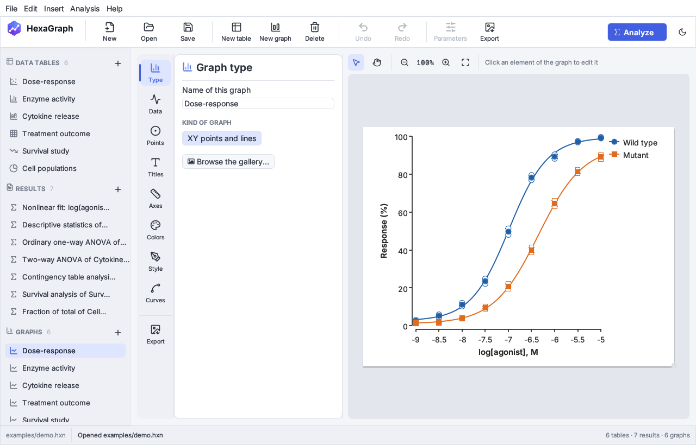

## Download

Get the latest version from the [**Releases page**](../../releases/latest). No
installation of Rust or anything else is needed.

| System | File | How to start it |
|---|---|---|
| **Windows** 10/11 (64-bit) | `HexaGraph-windows-x64.zip` | Unzip, then double-click `HexaGraph.exe`. If SmartScreen warns you, click *More info → Run anyway*. |
| **macOS** 11 or later (Apple silicon and Intel) | `HexaGraph-macos-universal.zip` | Unzip and move `HexaGraph.app` to *Applications*. The app is not notarized by Apple, so the first time macOS blocks it: open *System Settings → Privacy & Security* and click *Open Anyway* (on macOS 14 and earlier, right-click the app and choose *Open*). From the Terminal: `xattr -dr com.apple.quarantine /Applications/HexaGraph.app`. |
| **Linux** (x86-64, glibc 2.35 or later) | `HexaGraph-linux-x64.tar.gz` | Extract, then run `./install.sh` to add HexaGraph to your applications menu, or start `./hexagraph` directly. |

Each download includes `demo.hxn`, a sample project with every kind of table.
Open it from *File → Open* to explore.

## How it works

**1. Choose the kind of table and a graph.** XY, Column, Grouped, Contingency,
Survival or Parts of whole, with a preview of every graph type. Start empty or
from sample data.

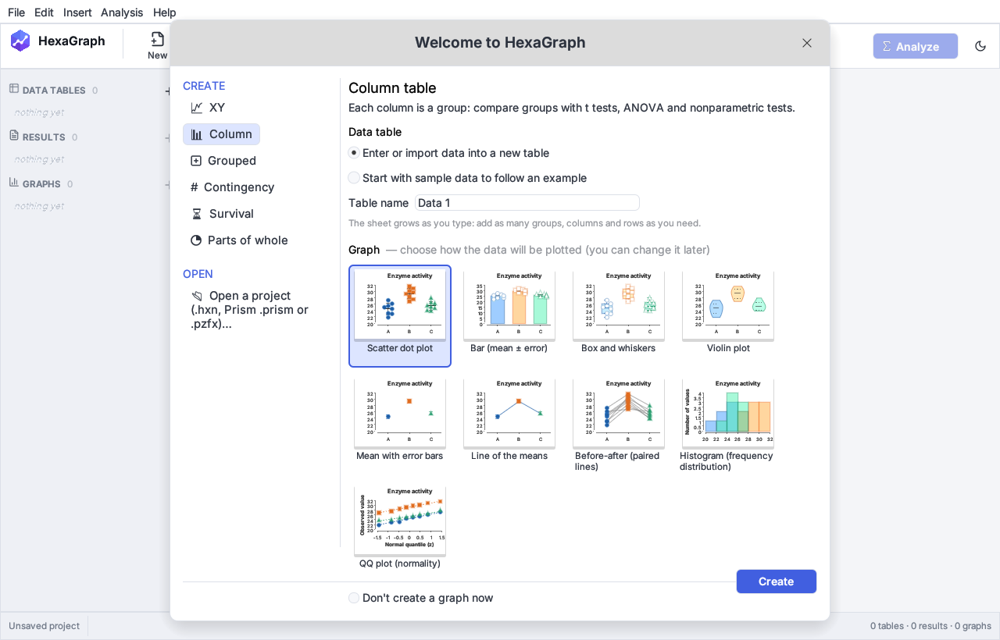

**2. Enter or paste your data.** The sheet works like a spreadsheet and grows as
you type: arrows, Tab and Enter move between cells, Ctrl+V pastes a block from
Excel, CSV/TSV files can be imported, and values can be excluded (struck
through) without deleting them.

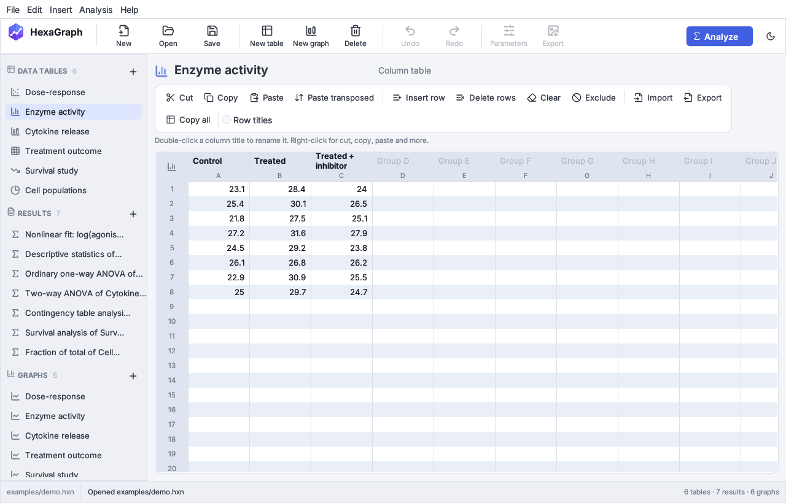

**3. Analyze, with advice.** Pick a test from a categorized list. The *Data
check* panel looks at your data first. It shows n, mean, SD and median for each
group, then checks for a Gaussian distribution and for outliers, which you can
exclude with one click. It also checks whether the SDs are similar. From these
checks it recommends a test and explains why, with the follow-up comparisons
to run and the alternative if an assumption is in doubt.

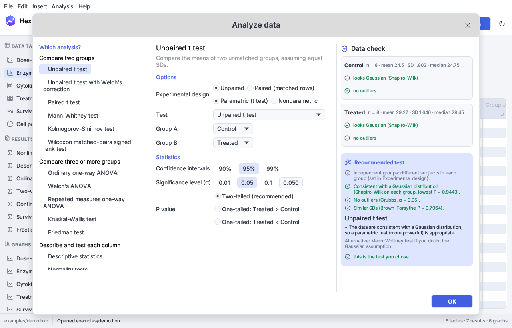

**4. Read the results.** Result sheets look like a lab report: summary, ANOVA
table, multiple comparisons, with P values summarized as `ns`, `*` … `****`.
Results are live: they recalculate when the data change.

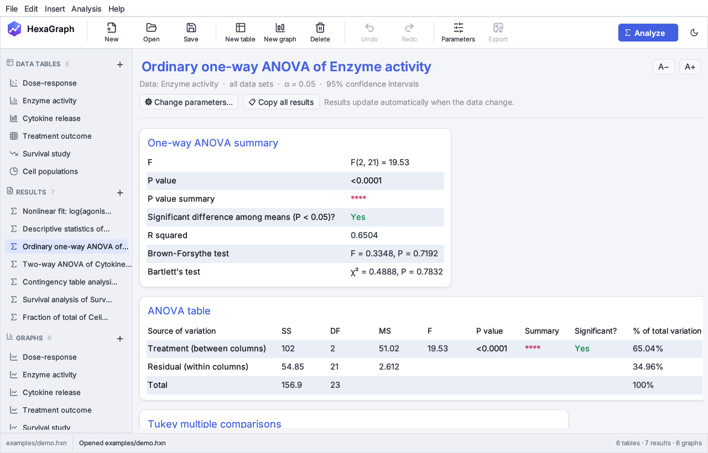

**5. Make the graph you need.** Pick from a gallery of previews. Below them,
HexaGraph suggests the graphs that suit your data and says why: for example,
show every point when the groups are small, or a violin when there are many
values.

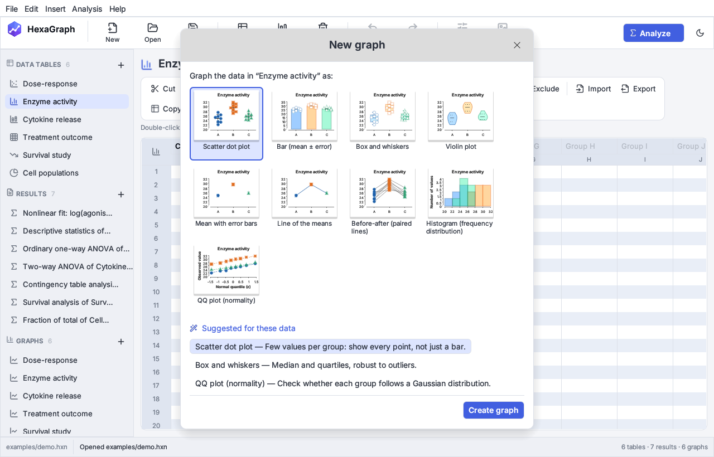

**6. Polish and export.** A tool strip opens the options for type, data,
titles, axes, significance stars, colors, style and fitted curves. You can
drag titles and legends with the mouse. Export to PNG, JPEG, TIFF or SVG at
the resolution journals ask for.

| Significance brackets, live from a test | Colors: disc, harmony, values, palettes |
|---|---|
| 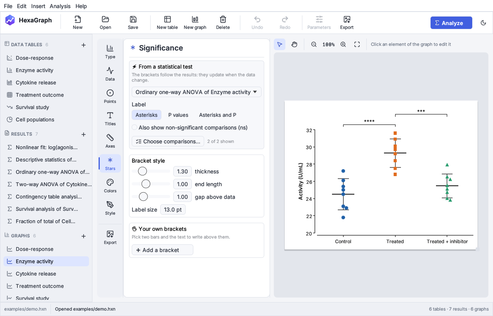 | 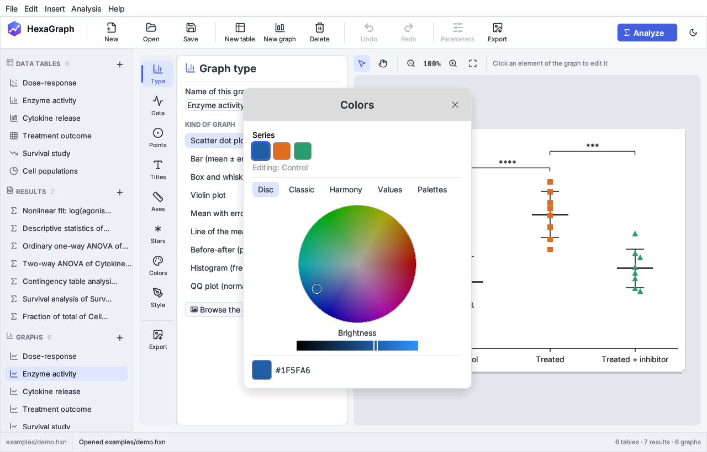 |
| **Grouped data** | **Survival curves** |
| 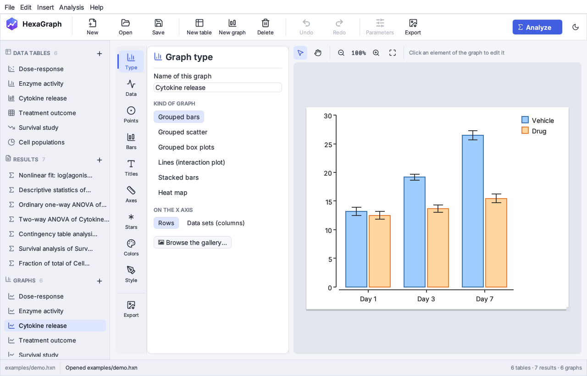 | 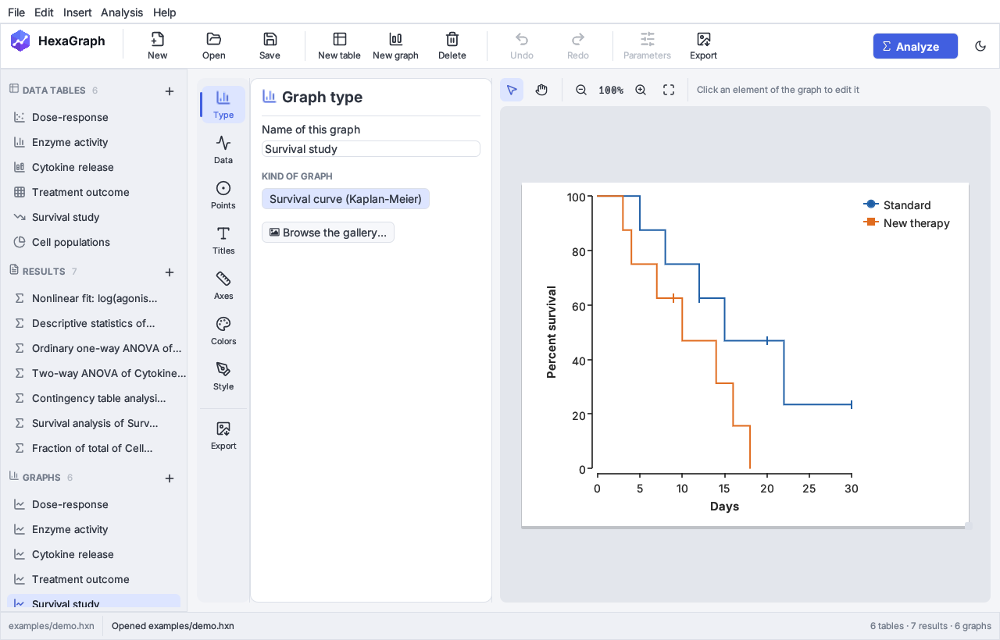 |
| **Export at 300 dpi or as vector** | **Dark theme** |
| 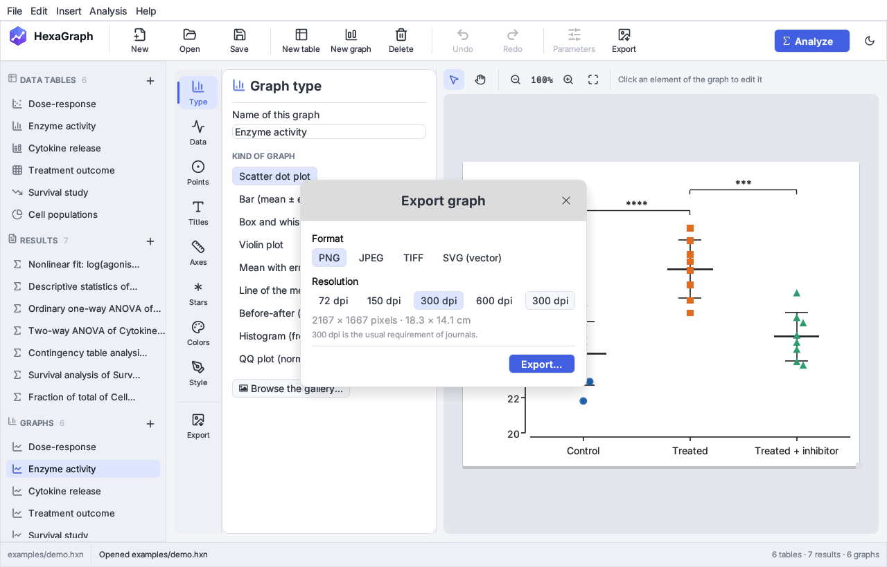 | 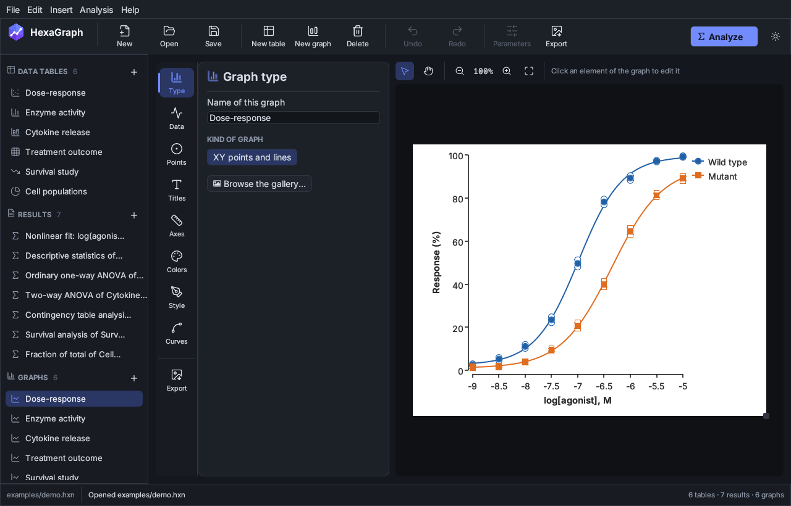 |

## Features

### Data tables
XY · Column · Grouped (two factors, with replicates) · Contingency · Survival ·
Parts of whole. Paste blocks from a spreadsheet, import CSV/TSV, exclude values
from every analysis or from one analysis only, undo and redo everything.

### Working with many tables and graphs
* **Change the kind of a table at any time** (XY, Column, Grouped, …) from the
  menu next to its name: the values are kept, replicates become rows when the
  new kind has none.
* **Duplicate a family**: right-click a table (or anything in the *Family*
  box) and duplicate the data with its analyses and graphs, or the data only;
  analyses and graphs can be duplicated one by one too.
* **Drag and drop** a HexaGraph (`.hxn`) or Prism (`.pzfx`, `.prism`) file on
  the window to add its tables, analyses and graphs to the open project.
* **Apply a look to several graphs at once**, even in different families:
  colors, symbols, fonts, lines and sizes are copied, data and titles stay.
  Looks can be saved, reused in every project, and shared as `.hxlook` files.
* **10 palettes of 8 colors** in one list. Use a whole palette, start it from
  any of its colors, or click colors one by one to give each data set its own.
* `.hxn` files have their own icon in Windows Explorer, the macOS Finder and
  Linux file managers (after `install.sh`).

### Statistics
Every method is implemented from the published literature and tested against
reference values computed with **R** and **SciPy** (`cargo test`).

| Area | Methods |
|---|---|
| Descriptive | n, mean, SD, SEM, CI, median, quartiles, range, CV, geometric mean / SD factor, harmonic mean, skewness, kurtosis |
| Normality | D'Agostino-Pearson, Anderson-Darling, Shapiro-Wilk (Royston), Kolmogorov-Smirnov (Lilliefors) |
| Two groups | Unpaired t (Student, Welch), paired t, one-sample t, F test for variances, Mann-Whitney (exact, ties included), Wilcoxon signed rank (exact), Kolmogorov-Smirnov, Hodges-Lehmann |
| Several groups | One-way ANOVA (with Brown-Forsythe and Bartlett tests), Welch's ANOVA, repeated-measures ANOVA (Geisser-Greenhouse ε), Kruskal-Wallis, Friedman |
| Multiple comparisons | Tukey(-Kramer), Dunnett, Games-Howell, Dunn, Bonferroni, Šídák, Holm-Šídák, Fisher LSD; Holm and Benjamini-Hochberg adjustments |
| Two-way | Two-way ANOVA with Type III sums of squares (also unbalanced), repeated measures, comparisons within rows or columns, multiple t tests per row |
| Regression | Linear regression with confidence band, Pearson and Spearman correlation |
| Curve fitting | Levenberg-Marquardt with 17 models: dose-response (agonist/inhibitor, 3 and 4 parameters), one/two-phase exponential decay, association, exponential growth, Michaelis-Menten, binding (specific/total), Gaussian, lognormal, Boltzmann, polynomials, power. Parameters can be held constant. Reports SE, CI, EC50/IC50, half-life, R², Sy.x |
| Survival | Kaplan-Meier (Greenwood SE, log-log CI, median), log-rank (Mantel-Cox) and Gehan-Breslow-Wilcoxon for k groups, test for trend, hazard ratio |
| Contingency | Chi-square (with or without Yates), Fisher's exact, relative risk, odds ratio, difference of proportions, chi-square for trend |
| Other | Grubbs' outlier test, area under the curve, Bland-Altman, ROC curve (AUC with Hanley-McNeil SE), fraction of total |

### Graphs
Scatter dot plot · bar · box and whiskers · violin · mean ± error · line of the
means · before-after · histogram · QQ plot · grouped and stacked bars · grouped
scatter, box and lines · heat map · XY with fitted curves · Kaplan-Meier
survival curves · pie and donut.

Error bars (SD, SEM, 95% CI, range), linear or log axes, significance brackets
(`ns`, `*` … `****` or exact P values) typed by hand or following a test live,
colour-blind-friendly palettes, custom colors, symbols, fonts and line widths.

### Prism files
Open Prism projects directly: `.pzfx` (XML) and Prism 10 `.prism` files. Data
tables and excluded values are imported, graphs are rebuilt. Analyses in
`.prism` files are recalculated by HexaGraph, and each result shows the values
Prism reported next to HexaGraph's own, so you can compare them.

## Building from source

You need a recent stable Rust toolchain ([rustup.rs](https://rustup.rs)).

```bash
cargo run --release -p hexagraph -- examples/demo.hxn
```

Run the test suite:

```bash
cargo test --workspace
```

On Linux the app needs only the usual X11 or Wayland session. File dialogs use
the XDG desktop portal.

### Making a release

Push a version tag. GitHub Actions builds Windows, macOS (universal) and Linux
packages and publishes them on the Releases page
([`.github/workflows/release.yml`](.github/workflows/release.yml)):

```bash
git tag v0.1.0
git push origin v0.1.0
```

## Project layout

| Crate | Purpose |
|---|---|
| `crates/hg-stats` | Statistics engine. Pure Rust, no GUI, usable as a library |
| `crates/hg-core` | Document model: tables, analyses, test advice, result sheets, `.hxn` project files (JSON), Prism import |
| `crates/hg-plot` | Graph layout into a backend-independent scene, plus SVG output |
| `crates/hg-app` | Desktop application ([egui](https://github.com/emilk/egui)) |

`cargo run -p hg-plot --example gallery -- out/` writes an SVG of every graph
type.

## Status and roadmap

HexaGraph is at an early stage (0.1). See [ROADMAP.md](ROADMAP.md) for what
is still missing, and [CONTRIBUTING.md](CONTRIBUTING.md) for how to help.

## Relationship to other software

HexaGraph is an independent project, inspired by the table → analysis →
graph workflow that is common in commercial scientific software. It is not
affiliated with any vendor. No code, artwork or documentation from proprietary
products was used. All statistics come from the published literature cited in
the source.

## Credits

* [Inter](https://rsms.me/inter/) typeface by Rasmus Andersson — SIL Open Font License (`assets/fonts/OFL-Inter.txt`).
* [Lucide](https://lucide.dev) icons — ISC License (`assets/icons/LICENSE-lucide.txt`).

## License

GNU General Public License v3.0 or later. See [LICENSE](LICENSE).

---

### In breve (italiano)

HexaGraph è un programma open source per grafici scientifici e statistica,
scritto in Rust. Si inseriscono i dati in tabelle e si lanciano le analisi: il
programma consiglia il test più adatto e spiega perché. Si ottengono grafici
pronti per la pubblicazione, che si aggiornano da soli quando cambiano i dati.
Apre anche i file di Prism (`.pzfx` e `.prism`) e confronta i risultati.
**Download** per Windows, macOS e Linux dalla pagina
[Releases](../../releases/latest).
